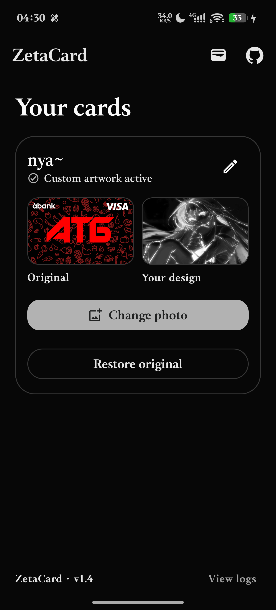
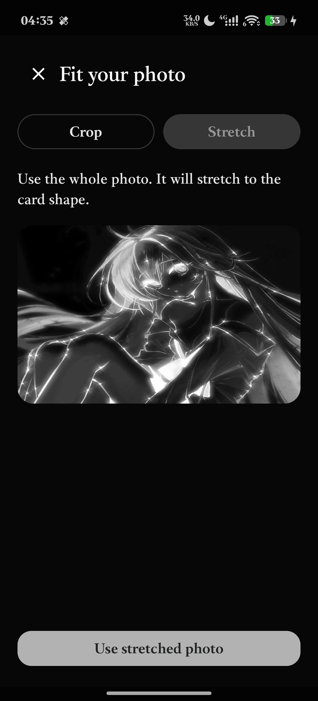
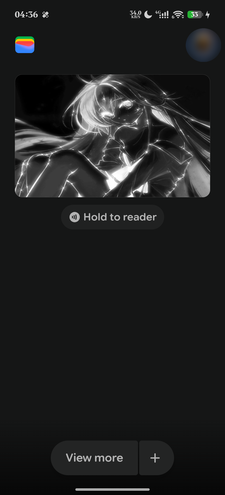

# ZetaCard

ZetaCard is an original Android LSPosed module for giving Google Wallet payment cards custom artwork. Its English-only Material 3 manager shows the original card artwork beside your design. You can pick a photo, crop it to card proportions or stretch it to fit, rename the local card entry, or restore the original appearance.

The module changes artwork in the Wallet user interface. It does not edit payment credentials, NFC services, or Google Play Services.

## Screenshots

| Your cards | Crop editor | In Google Wallet |
|:---:|:---:|:---:|
|  |  |  |

## Requirements

- Android 10 or newer
- Google Wallet
- LSPosed / Vector with Modern API 102
- Root (KernelSU, Magisk, or similar), with root access granted to ZetaCard

## Build

Use JDK 17 or newer and Android SDK 37. The included Gradle wrapper downloads Gradle 9.7.1:

```sh
./gradlew assembleDebug
```

The APK is created at `app/build/outputs/apk/debug/app-debug.apk`.

GitHub Actions builds a debug APK on every push and publishes it as a preview in [Releases](https://github.com/hxfuxyy/ZetaCard/releases). To publish a versioned release, select **Actions → Build APK → Run workflow** and enter a version name and a higher Android version code. Push builds use version 1.4 and code 140; change the workflow defaults to change those values. GitHub Actions APKs are debug-signed on its runner, so APKs from separate runs may require uninstalling the previous build before installation. A stable signing key is needed for seamless upgrades between runs.

## Setup

On first launch ZetaCard shows a welcome screen that checks and reports whether root access and the LSPosed/Vector module are granted, so you can confirm both before continuing.

1. Install the APK.
2. Enable ZetaCard in LSPosed or Vector with `com.google.android.apps.walletnfcrel` in scope.
3. Grant ZetaCard root access when your root manager (KernelSU, Magisk, or similar) prompts, or allow it manually in the manager. ZetaCard uses root only to read the list of discovered cards back from Google Wallet; the artwork itself is changed by the LSPosed module inside Wallet.
4. Force stop and reopen Google Wallet and view your cards once. The module writes the discovered card list into Wallet's own private storage.
5. Open ZetaCard. It reads that list with root, shows your payment cards with previews of their original artwork, then choose and crop an image for a card and reopen Wallet.

Discovered cards are written by the module into Google Wallet's private storage and read back by ZetaCard with root, so the card list no longer depends on a cross-app content provider that Google Wallet stops being able to reach after an update or when the system freezes ZetaCard in the background. Original previews and custom artwork are saved in ZetaCard's private app storage; custom artwork is also copied to LSPosed's private module storage so it stays available when the ZetaCard interface is closed. Restoring a card removes both copies. The module derives a local SHA-256 ID from the card artwork URL. ZetaCard itself never saves the URL. The selected art remains visible with Wallet's masked card digits over it.

ZetaCard finds the artwork hooks on its own. Rather than matching one exact obfuscated shape, the scan collects every plausible candidate class and method, scores each against the known card layout, and installs the best match, so most Wallet updates no longer need a manual hook detection. A scan that resolves nothing is not cached, so the next time Wallet starts the module simply scans again until it finds the new shape. ZetaCard still saves the resolved hook map per Wallet version to avoid rescanning on every launch. **Detect hooks** forces a fresh scan and reloads the module in a running Wallet process if you ever want to re-run it by hand. **View logs** shows app events for the current app session, including when ZetaCard is in the background. The session log clears when the app is fully closed and reopened. **Export** saves a text report with app events, device and firmware details, and app versions. Wallet hook events are available in LSPosed logs.

## Compatibility

Developed against OnePlus Ace 6T, Android 16, Vector 1.2, and Google Wallet `26.41.996630916`, including its Compose card screen. Wallet is obfuscated and changes often. ZetaCard's hook discovery is tolerant of the layout drifting between releases and re-scans automatically until it locks onto the new shape, so it is designed to keep working across most Wallet updates without a code change. If Wallet ever restructures its card renderer beyond what the scan can recognise, the module leaves Wallet's original artwork visible until ZetaCard is updated rather than painting over the wrong view. NFC payments were not exercised as part of visual testing.

## Source and permissions

Copyright (c) 2026 hxfuxyy. All rights reserved. The [ZetaCard Source License](LICENSE) allows viewing and forking on GitHub and personal use of official APKs. It does not grant permission to reuse, modify, build, or redistribute the original source code. Third-party dependencies keep their own licenses.

GitHub: https://github.com/hxfuxyy/ZetaCard
