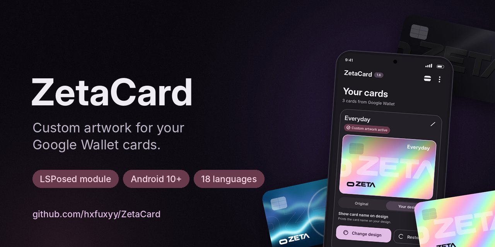
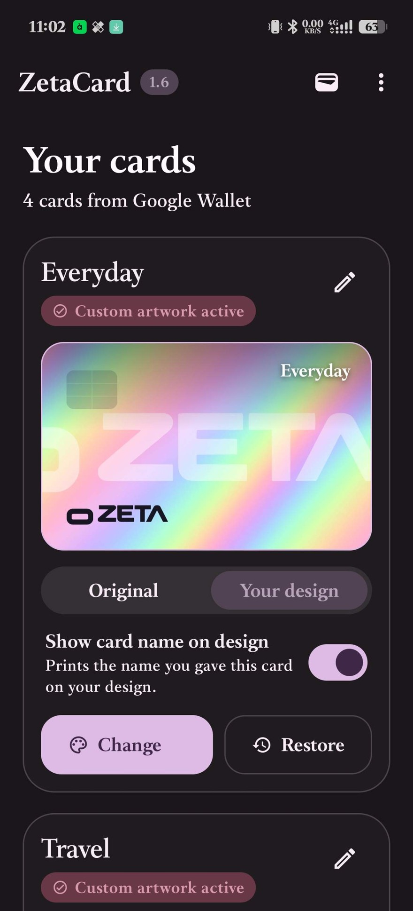
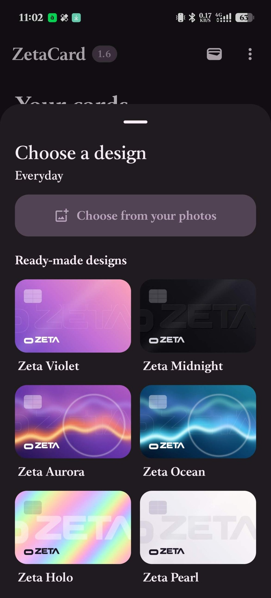
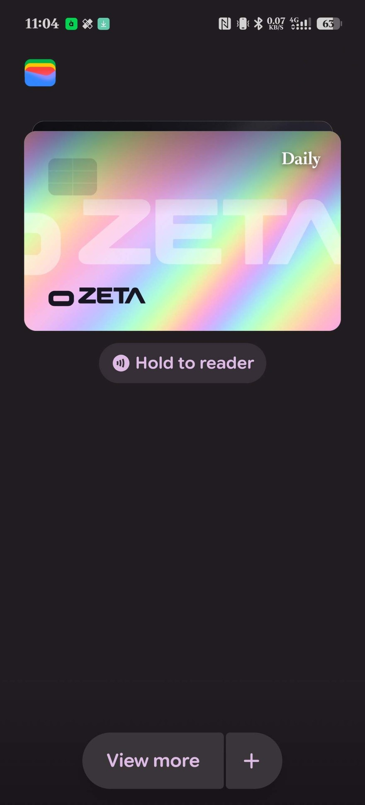

<div align="center">



[](https://github.com/hxfuxyy/ZetaCard/actions/workflows/ci.yml)
[](https://github.com/hxfuxyy/ZetaCard/releases/latest)
[](https://github.com/hxfuxyy/ZetaCard/releases)
[](#requirements)
[](LICENSE)

**[Download the latest release](https://github.com/hxfuxyy/ZetaCard/releases/latest)** · [Changelog](CHANGELOG.md) · [Report a problem](https://github.com/hxfuxyy/ZetaCard/issues/new/choose)

</div>

ZetaCard is an LSPosed module that replaces the artwork of your payment cards inside Google Wallet. Pick one of the built-in Zeta designs or use any photo, preview it next to the original, and switch back with one tap.

ZetaCard only changes how card artwork is drawn in the Wallet user interface. It does not read or modify payment credentials, tokens, NFC services or Google Play Services.

## Screenshots

| Your cards | Zeta designs | In Google Wallet |
|:---:|:---:|:---:|
|  |  |  |

## Features

- **Your own card artwork** with a large preview that switches between the original and your design.
- **Six built-in Zeta designs** (Violet, Midnight, Aurora, Ocean, Holo, Pearl) that fit the card exactly and apply with one tap.
- **Photo editor** with pinch-to-zoom, drag, or stretch, plus brightness and shade controls.
- **Card name on the design** so cards stay easy to tell apart.
- **Backup and restore** of every design and card name in a single file.
- **Automatic card scan**: when no cards are known yet, or when you pull down to refresh, ZetaCard opens Google Wallet for a moment, reads your cards and comes back by itself.
- **18 languages**, selectable inside the app under **⋮ → Language**: English, Ukrainian, Russian, Spanish, Portuguese (Brazil), French, German, Italian, Polish, Turkish, Vietnamese, Indonesian, Japanese, Korean, Chinese (Simplified and Traditional), Hindi and Arabic.
- **Detailed diagnostics**: **⋮ → View logs → Export** creates one file with your device, root, LSPosed and Wallet details plus the event logs, ready to attach to an issue.
- Automatic discovery of Wallet's artwork renderer, cached per Wallet version and rescanned after updates.
- Material 3 with dynamic color and smooth animations throughout.

## Requirements

- Android 10 (API 29) or newer
- Google Wallet (`com.google.android.apps.walletnfcrel`)
- LSPosed or Vector with libxposed API 102
- Root access (KernelSU, Magisk or similar) granted to ZetaCard

## Compatibility

ZetaCard locates Wallet's internal artwork classes at runtime instead of relying on hard-coded names, so it usually survives Wallet updates. Google can still change Wallet in ways that break detection, and no list of supported Wallet versions is maintained. If artwork stops applying after an update, open **⋮ → View logs** and [report it](https://github.com/hxfuxyy/ZetaCard/issues/new/choose) with the exported logs.

### Known limitations

- Cards are identified by the URL of their artwork image. Two cards that share exactly the same artwork image therefore share one design, and if Google changes a card's artwork URL the card appears as a new entry.
- "Custom artwork active" means the design reached the LSPosed module. Whether Wallet displays it still depends on the hooks resolving for your Wallet version; check the logs if it does not appear.

## Installation

1. Download `ZetaCard-<version>.apk` from [Releases](https://github.com/hxfuxyy/ZetaCard/releases/latest) and optionally compare it with the published `.sha256` file.
2. Install the APK.
3. In LSPosed or Vector, enable ZetaCard and make sure Google Wallet is in its scope.
4. In your root manager (KernelSU, SukiSU, APatch or Magisk), make sure **Umount modules** or **DenyList** is turned **off** for Google Wallet (`com.google.android.apps.walletnfcrel`) so LSPosed can inject into its process. Keep unmount / DenyList enabled for Google Play Services and Play Store.
   > **Note:** Root managers store unmount profiles per UID. If you reinstall Google Wallet, its UID changes and the profile resets to default with unmount enabled. Check and re-save this profile after reinstalling Wallet.
5. Open ZetaCard and allow root access when your root manager asks.
6. Force stop Google Wallet, open it, and view your cards once.

> [!IMPORTANT]
> **Updating from 1.5:** install 1.6 over the existing app. Your designs and settings are kept.
>
> **Updating from 1.4 or older** (package `dev.zxcwsurx.zetacard`): install 1.6 next to the old app and open it once with root to copy your designs and card names, then uninstall the old app.
>
> In both cases, enable the new ZetaCard in LSPosed or Vector with Google Wallet in scope, then force stop and reopen Wallet.

## Usage

1. Open ZetaCard and finish setup. It checks that root is granted, the LSPosed module is active and Google Wallet is in the module scope.
2. ZetaCard opens Google Wallet for a moment to find your cards and returns automatically. Pull down any time to scan again.
3. Tap **Choose design**. Pick a Zeta design, or choose a photo and crop or stretch it to the card frame. Use **Adjust** for brightness and shade.
4. ZetaCard saves the design, syncs it to the module and restarts Wallet.
5. Turn on **Show card name on design** to print the card's name on your artwork. Rename a card with the pencil icon.
6. Use **Restore** on a card to return to the original artwork.
7. Before reinstalling or switching devices, use **⋮ → Back up designs**, and **⋮ → Restore from backup** afterwards.

## Troubleshooting

| Problem | What to try |
|---|---|
| No cards appear or logs show no Wallet events | 1. Ensure ZetaCard is enabled in LSPosed with Google Wallet in scope.<br>2. In your root manager (KernelSU, SukiSU, APatch or Magisk), ensure **Umount modules** or **DenyList** is turned **off** for Google Wallet (keep it on for Google Play Services). If you reinstalled Wallet, re-check this profile because its UID changed.<br>3. Force stop Wallet, open it, view your cards, and pull down in ZetaCard to refresh. |
| Setup does not let me continue | Both checks must pass. Grant root to ZetaCard in your root manager and enable the module in LSPosed with Google Wallet in scope, then tap **Check again**. |
| Something else went wrong | Open **⋮ → View logs → Export** and attach the file to a [new issue](https://github.com/hxfuxyy/ZetaCard/issues/new/choose). |
| Artwork does not change | Reopen Wallet once more. After installing or updating ZetaCard or Wallet, the module scans Wallet in the background on first launch and applies hooks on the next one. |
| Logs show "Compose card structure not resolved" | Your Wallet version is not recognised. Please open an issue with exported logs. |
| Wallet is slow to open or does not open | Update to ZetaCard 1.5 or newer, which moved the Wallet scan off the main thread. Include exported logs if it still happens. |

## Building from source

Requirements: JDK 17 or newer (CI uses 21) and the Android SDK with platform 37. The Gradle wrapper downloads Gradle automatically.

```sh
./gradlew testDebugUnitTest   # unit tests
./gradlew lintDebug           # Android lint
./gradlew assembleDebug       # app/build/outputs/apk/debug/app-debug.apk
```

The version is defined once in [`version.properties`](version.properties). Release signing is configured through environment variables or a local `keystore.properties`; see [docs/RELEASING.md](docs/RELEASING.md).

## Security and privacy

ZetaCard has no analytics or tracking. The only network request it makes is downloading the original card artwork image from Google's `googleusercontent.com` servers over HTTPS. Read [PRIVACY.md](PRIVACY.md) for details and [SECURITY.md](SECURITY.md) to report a vulnerability.

## FAQ

**Is it safe for payments?** ZetaCard only replaces images in Wallet's interface and does not touch payment data or NFC. As with any root or Xposed modification, your bank or Google may still treat a modified device differently.

**Does anyone else see my artwork?** No. The artwork exists only on your device.

**Why does it need root?** The module writes your card list inside Wallet's private storage, and ZetaCard reads it with root. Root is also used to restart Wallet after you change artwork.

## Contributing

Contributions are welcome. Please read [CONTRIBUTING.md](CONTRIBUTING.md) before opening a pull request.

## License

Copyright (c) 2026 hxfuxyy. ZetaCard is released under the [ZetaCard Source License 2.0](LICENSE). You may fork, modify, build and publish your own versions as long as you keep the license and clearly credit the original project: every fork must state that it is based on ZetaCard by hxfuxyy and link to this repository. Selling ZetaCard or derivatives requires permission. Third-party components keep their own licenses; see [THIRD_PARTY_NOTICES.md](THIRD_PARTY_NOTICES.md).
