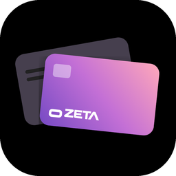
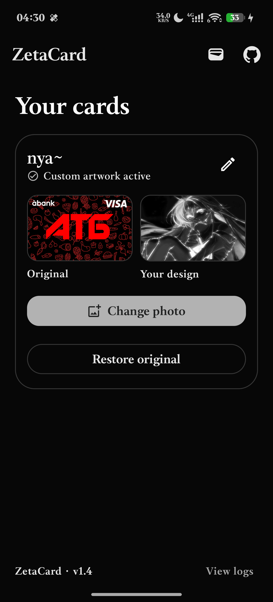
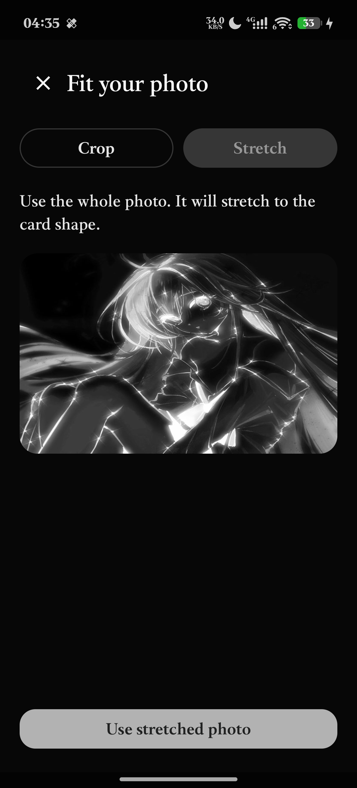
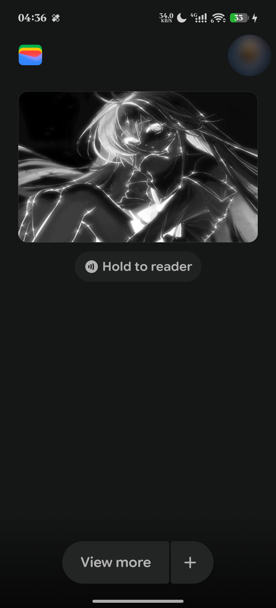

<div align="center">



# ZetaCard

Customize Google Wallet card artwork with a modern Material 3 LSPosed module for Android.

[](https://github.com/hxfuxyy/ZetaCard/actions/workflows/ci.yml)
[](https://github.com/hxfuxyy/ZetaCard/releases/latest)
[](#requirements)
[](LICENSE)

**[Download the latest release](https://github.com/hxfuxyy/ZetaCard/releases/latest)**

</div>

ZetaCard is an LSPosed module that replaces the artwork of your payment cards inside Google Wallet with images you choose. Its manager app shows the original artwork next to your design, lets you crop or stretch a photo to the card shape, and restores the original look with one tap.

ZetaCard only changes how card artwork is drawn in the Wallet user interface. It does not read or modify payment credentials, tokens, NFC services or Google Play Services.

## Screenshots

| Your cards | Crop editor | In Google Wallet |
|:---:|:---:|:---:|
|  |  |  |

## Features

- Custom artwork for each card, with the original artwork shown side by side.
- Crop editor with pinch-to-zoom and drag, or stretch the whole photo to the card shape.
- Automatic discovery of Wallet's artwork renderer, cached per Wallet version and rescanned after updates.
- Wallet is restarted automatically so changes apply immediately.
- Local card names, restore to original, and built-in diagnostic logs you can copy or export.
- Material 3 interface with dynamic color on Android 12 and newer.

## Requirements

- Android 10 (API 29) or newer
- Google Wallet (`com.google.android.apps.walletnfcrel`)
- LSPosed or Vector with libxposed API 102
- Root access (KernelSU, Magisk or similar) granted to ZetaCard

## Compatibility

ZetaCard locates Wallet's internal artwork classes at runtime instead of relying on hard-coded names, so it usually survives Wallet updates. Google can still change Wallet in ways that break detection, and no list of supported Wallet versions is maintained. If artwork stops applying after an update, open **⋮ → View logs** and [report it](https://github.com/hxfuxyy/ZetaCard/issues/new/choose) with the exported logs.

### Known limitations

- Cards are identified by the URL of their artwork image. Two cards that share exactly the same artwork image therefore share one design, and if Google changes a card's artwork URL the card appears as a new entry.
- "Custom artwork active" means the design reached the LSPosed module. Whether Wallet displays it still depends on the hooks resolving for your Wallet version; check the logs if it does not appear.

## Installation

1. Download `ZetaCard-<version>.apk` from [Releases](https://github.com/hxfuxyy/ZetaCard/releases/latest) and optionally compare it with the published `.sha256` file.
2. Install the APK.
3. In LSPosed or Vector, enable ZetaCard and make sure Google Wallet is in its scope.
4. In your root manager (KernelSU, SukiSU, APatch or Magisk), make sure **Umount modules** or **DenyList** is turned **off** for Google Wallet (`com.google.android.apps.walletnfcrel`) so LSPosed can inject into its process. Keep unmount / DenyList enabled for Google Play Services and Play Store.
   > [!NOTE]
   > Root managers store unmount profiles per UID. If you reinstall Google Wallet, its UID changes and the profile resets to default with unmount enabled. Check and re-save this profile after reinstalling Wallet.
5. Open ZetaCard and allow root access when your root manager asks.
6. Force stop Google Wallet, open it, and view your cards once.

> [!IMPORTANT]
> Starting with 1.5, ZetaCard uses the package name `io.github.hxfuxyy.zetacard` (previously `dev.zxcwsurx.zetacard`) and is signed with a permanent release key. Android treats it as a new app, so it installs next to the old one:
>
> 1. Install 1.5 and open it. With root granted, it copies your designs and card names from the old app.
> 2. Uninstall the old ZetaCard. The app shows a reminder while it is still installed.
> 3. In LSPosed or Vector, enable the new ZetaCard with Google Wallet in scope, then force stop and reopen Wallet.

## Usage

1. Open ZetaCard. Your Wallet cards appear with their original artwork. Pull down to refresh the list.
2. Tap **Choose photo**, pick an image, and crop or stretch it to the card frame.
3. Tap **Apply crop**. ZetaCard saves the artwork, syncs it to the module and restarts Wallet.
4. Use **Restore** on a card to return to the original artwork, or the pencil icon to rename it locally.

## Troubleshooting

| Problem | What to try |
|---|---|
| No cards appear or logs show no Wallet events | 1. Ensure ZetaCard is enabled in LSPosed with Google Wallet in scope.<br>2. In your root manager (KernelSU, SukiSU, APatch or Magisk), ensure **Umount modules** or **DenyList** is turned **off** for Google Wallet (keep it on for Google Play Services). If you reinstalled Wallet, re-check this profile because its UID changed.<br>3. Force stop Wallet, open it, view your cards, and pull down in ZetaCard to refresh. |
| Root access shows "Not granted" | Grant root to ZetaCard in your root manager, then tap **Check again**. |
| Artwork does not change | Reopen Wallet once more. After installing or updating ZetaCard or Wallet, the module scans Wallet in the background on first launch and applies hooks on the next one. |
| Logs show "Compose card structure not resolved" | Your Wallet version is not recognised. Please open an issue with exported logs. |
| Wallet is slow to open or does not open | Update to ZetaCard 1.5 or newer, which moved the Wallet scan off the main thread. Include exported logs if it still happens. |

## Building from source

Requirements: JDK 17 or newer (CI uses 21) and the Android SDK with platform 37. The Gradle wrapper downloads Gradle automatically.

```sh
./gradlew testDebugUnitTest   # unit tests
./gradlew lintDebug           # Android lint
./gradlew assembleDebug       # app/build/outputs/apk/debug/app-debug.apk
```

The version is defined once in [`version.properties`](version.properties). Release signing is configured through environment variables or a local `keystore.properties`; see [docs/RELEASING.md](docs/RELEASING.md).

## Security and privacy

ZetaCard has no analytics or tracking. The only network request it makes is downloading the original card artwork image from Google's `googleusercontent.com` servers over HTTPS. Read [PRIVACY.md](PRIVACY.md) for details and [SECURITY.md](SECURITY.md) to report a vulnerability.

## FAQ

**Is it safe for payments?** ZetaCard only replaces images in Wallet's interface and does not touch payment data or NFC. As with any root or Xposed modification, your bank or Google may still treat a modified device differently.

**Does anyone else see my artwork?** No. The artwork exists only on your device.

**Why does it need root?** The module writes your card list inside Wallet's private storage, and ZetaCard reads it with root. Root is also used to restart Wallet after you change artwork.

## Contributing

Contributions are welcome. Please read [CONTRIBUTING.md](CONTRIBUTING.md) before opening a pull request.

## License

Copyright (c) 2026 hxfuxyy. ZetaCard is released under the [ZetaCard Source License 2.0](LICENSE). You may fork, modify, build and publish your own versions as long as you keep the license and clearly credit the original project: every fork must state that it is based on ZetaCard by hxfuxyy and link to this repository. Selling ZetaCard or derivatives requires permission. Third-party components keep their own licenses; see [THIRD_PARTY_NOTICES.md](THIRD_PARTY_NOTICES.md).

## Credits

- [libxposed](https://github.com/libxposed) for the modern Xposed API and service library.
- [LSPosed](https://github.com/LSPosed/LSPosed) and Vector for the framework.
- [Primer Octicons](https://github.com/primer/octicons) for the GitHub mark.
