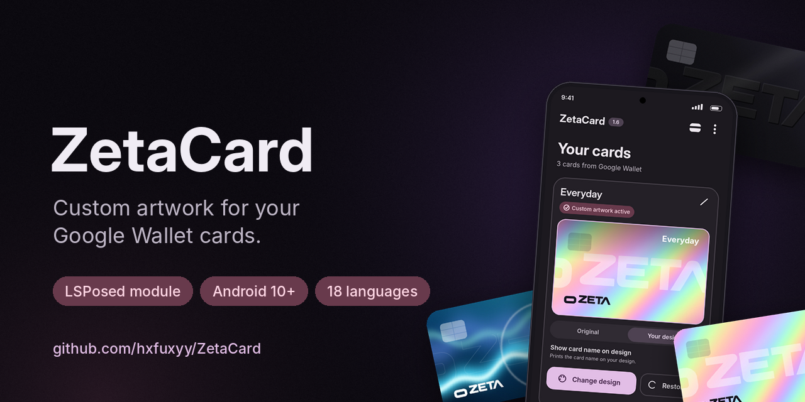
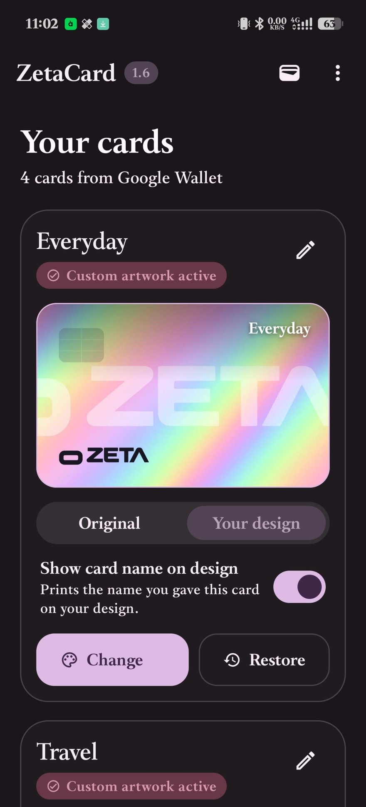
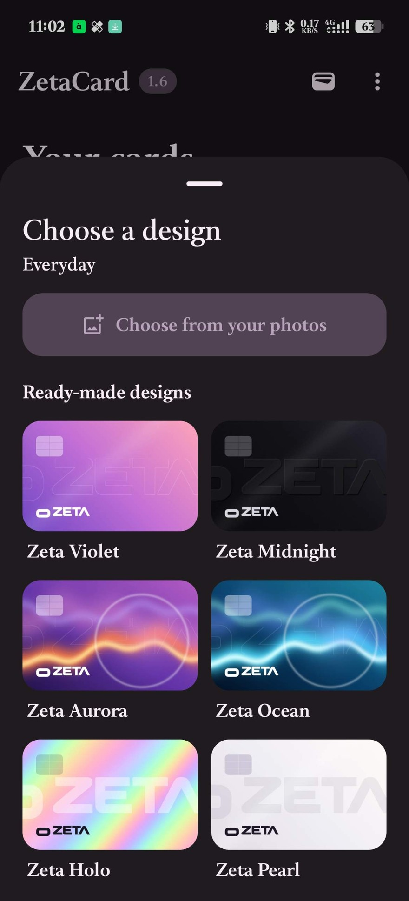
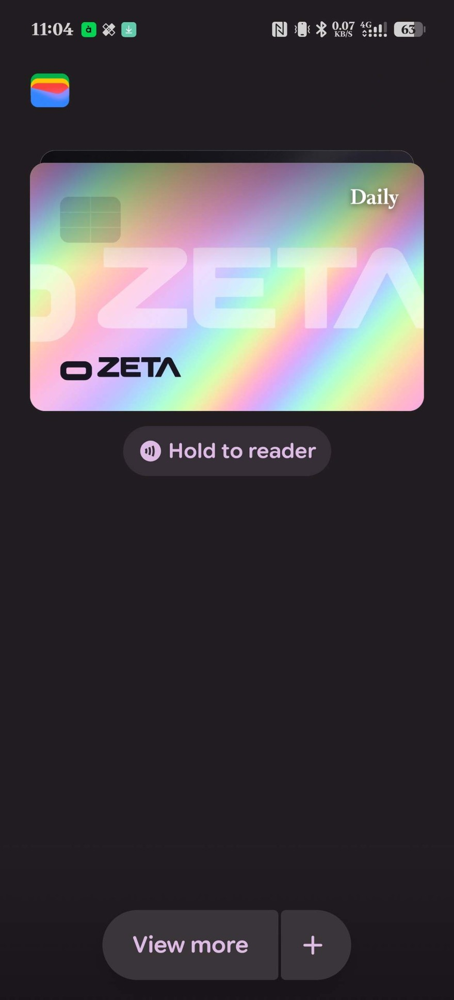

**Custom artwork for your Google Wallet cards.**

[Source code](https://github.com/hxfuxyy/ZetaCard) · [Changelog](https://github.com/hxfuxyy/ZetaCard/blob/main/CHANGELOG.md) · [Report a problem](https://github.com/hxfuxyy/ZetaCard/issues/new/choose)

ZetaCard replaces the artwork of your payment cards inside Google Wallet. Pick one of six built-in Zeta designs or use any photo, preview it next to the original, and switch back with one tap. It only changes how card artwork is drawn; payment data and NFC are never touched.

## Features

- Six built-in Zeta designs, or any photo with crop, stretch, brightness and shade
- Optional card name printed on the design
- Backup and restore of every design
- Finds your cards automatically
- 18 languages, Material 3 with dynamic color

## Requirements

- Android 10 or newer, Google Wallet
- LSPosed or Vector with libxposed API 102
- Root access granted to ZetaCard

## Setup

1. Install the APK and open ZetaCard.
2. Grant root, enable the module in LSPosed and tick **Google Wallet** in its scope.
3. In your root manager, turn off **Umount modules** / **DenyList** for Google Wallet.
4. Pick a design. ZetaCard applies it and restarts Wallet.

Full documentation and troubleshooting: [github.com/hxfuxyy/ZetaCard](https://github.com/hxfuxyy/ZetaCard)
